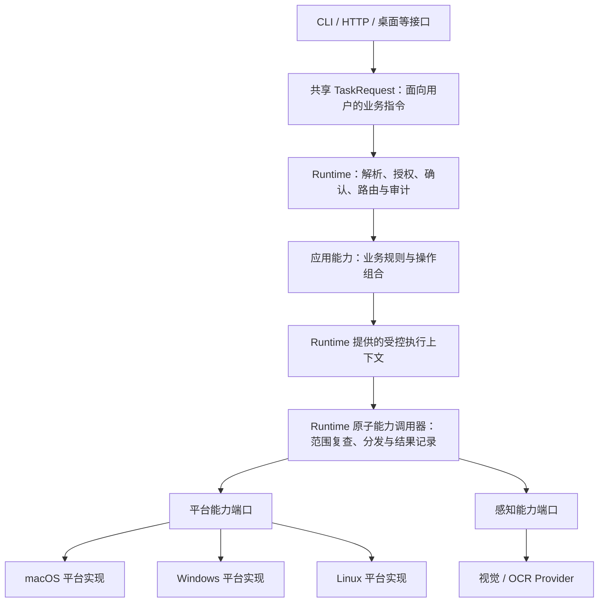

# DeskAgent 架构设计

> **架构模型：分层架构 + 插件扩展架构 + 统一能力调用链**  
> 目标：构建跨 App、跨操作系统、跨模型、可通过 API/SDK 调用的通用桌面智能代理平台。

> 本文描述目标架构；[RPA 协议草案（中文）](docs/RPA_PROTOCOL.zh-CN.md) / [英文](docs/RPA_PROTOCOL.md) 定义目标任务协议和标准本地实现要求，**不代表现有实现已符合**。当前实现范围见文末；草案中的目标要求不能作为现有接口、Schema 或行为的能力声明。

项目名称为 **DeskAgent**，项目包和命令名称使用 `desk-agent`。配置环境变量使用 `DESK_AGENT_*`；全项目只使用一个私有 SQLite 文件 `~/.desk-agent/desk_agent.sqlite3`（目录 `0700`、文件 `0600`），授权、审计、坐标缓存、指令队列与元数据分表存放；可通过 `DESK_AGENT_DB` 指定路径。`DATABASE_URL` 与 `DESK_AGENT_SECURITY_DB` 已移除；默认位置首次启动时若只存在旧 `~/.desk-agent/security.sqlite3`，会原样重命名为新文件以保留授权与审计。

---

## 1. 架构目标与设计原则

项目不应被设计成某个 App 的自动化脚本集合，而应定位为通用的 **Desktop Agent Platform / Runtime**。企业微信可以作为首个重点适配的应用，后续逐步扩展微信、钉钉、飞书、浏览器、邮件及其他桌面应用。

平台需要支持：

- **多种任务输入**：自然语言任务、精确能力指令、结构化工作流/API 调用。
- **多种执行通道**：官方 API、桌面 UI 自动化、浏览器自动化，以及后续接入的其他通道。
- **多种感知方式**：Accessibility、OCR、截图和支持视觉的大模型（VLM）。
- **多操作系统**：macOS、Windows、Linux。
- **多模型供应商**：LLM、VLM、OCR 服务可替换、可组合。
- **插件扩展**：App 插件、平台插件、模型 Provider 插件及第三方能力插件。
- **对外接口**：HTTP API、WebSocket、CLI、IPC，以及 Python / TypeScript SDK。

### 1.1 核心原则

1. Agent 负责理解、规划和选择能力，不直接调用 AppleScript、鼠标或键盘接口。
2. 所有可执行操作统一抽象为 Capability。
3. 所有 Capability 的执行必须经过 Runtime，不允许插件或 Agent 绕过 Runtime 直接执行受控操作。
4. App 业务语义与操作系统原语分离：`wecom.message.send` 不等于 `desktop.click`。
5. 插件通过明确的扩展点注册能力，不通过模块间随意互相引用实现扩展。
6. 通过 Ports / Traits 做依赖反转，核心业务不依赖具体 App、OS 或模型厂商。
7. 发送消息、删除数据、提交表单等有副作用的动作必须具备权限策略、必要的用户确认、审计和结果验证。
8. 初期优先采用模块化单体；接口稳定、确有独立部署或复用需求后再拆分 Crate 或进程。
9. **所有 Rust 源码统一放在项目根目录 `src/` 下。**

## 2. 总体架构：三种架构视角

```text
┌──────────────────────────────────────────────────────────────────┐
│                          外部接入层                               │
│             HTTP API / WebSocket / CLI / IPC / SDK                │
└───────────────────────────────┬──────────────────────────────────┘
                                │
                                ▼
┌──────────────────────────────────────────────────────────────────┐
│                         分层架构                                  │
│                                                                  │
│  接入层 → 应用用例层 → Agent 层 → 统一 Runtime 层                 │
│                                      │                           │
│                             Capability Registry                  │
│                                      │                           │
│                         Permission / Dispatcher                  │
│                                      │                           │
│                      Execute / Verify / Audit                    │
└──────────────────────────────────────┬───────────────────────────┘
                                       │
                                       ▼
┌──────────────────────────────────────────────────────────────────┐
│                       插件扩展架构                                │
│                                                                  │
│  App Plugins       Platform Plugins       Provider Plugins       │
│  WeCom             macOS                  LLM                     │
│  WeChat            Windows                VLM                     │
│  DingTalk          Linux                  OCR                     │
│  Feishu            Browser Engine         Third-party Plugins     │
└──────────────────────────────────────┬───────────────────────────┘
                                       │
                                       ▼
┌──────────────────────────────────────────────────────────────────┐
│                       统一能力调用链                              │
│                                                                  │
│  Request → Resolve → Authorize → Dispatch → Execute              │
│          → Verify → Audit → Response                              │
└──────────────────────────────────────────────────────────────────┘
```

这三种视角不是三套互相独立的系统：

- 分层架构定义代码组织和依赖方向。
- 插件架构定义扩展组件如何进入系统，以及如何注册能力。
- 统一能力调用链定义能力从被请求到执行完成的标准生命周期。

## 3. 一、分层架构

### 3.1 分层模型

建议使用以下逻辑层次。`kernel` 和 `domain` 为核心模型与契约，横切能力通过接口被各层使用，不构成允许任意依赖的“公共工具箱”。

```text
┌─────────────────────────────────────────────────────────────┐
│ L0 接入层 Interfaces                                         │
│ HTTP / WebSocket / CLI / IPC / SDK                           │
└──────────────────────────────┬──────────────────────────────┘
                               ▼
┌─────────────────────────────────────────────────────────────┐
│ L1 应用用例层 Application                                    │
│ TaskService / AgentService / CapabilityInvokeUseCase        │
│ AppManagement / Workflow                                     │
└──────────────────────────────┬──────────────────────────────┘
                               ▼
┌─────────────────────────────────────────────────────────────┐
│ L2 Agent 层 Agent                                            │
│ Parser / Planner / Reasoning / Memory / Selector             │
│ Natural Language Strategy / Exact Command Strategy          │
└──────────────────────────────┬──────────────────────────────┘
                               ▼
┌─────────────────────────────────────────────────────────────┐
│ L3 统一执行层 Runtime                                        │
│ Registry / Permission / Confirmation / Dispatcher           │
│ Retry / Timeout / Verification / Audit                       │
└──────────────────────────────┬──────────────────────────────┘
                               ▼
┌─────────────────────────────────────────────────────────────┐
│ L4 能力与适配器层                                            │
│ Generic Capabilities / App Adapters / Channel Adapters       │
└──────────────────────────────┬──────────────────────────────┘
                               ▼
┌─────────────────────────────────────────────────────────────┐
│ L5 基础设施与平台实现层                                      │
│ macOS / Windows / Linux / Browser / API Client / Database    │
│ LLM / VLM / OCR Providers / Filesystem / Network             │
└─────────────────────────────────────────────────────────────┘

横切关注点：Kernel Contracts、Domain Models、Config、Security、
Observability、Event Bus。
```

### 3.2 各层职责与边界

| 层 | 主要模块 | 负责什么 | 不负责什么 |
|---|---|---|---|
| L0 接入层 | `interfaces` | 接收外部请求、身份认证、协议转换、流式输出 | Agent 推理、直接操作桌面 |
| L1 应用用例层 | `application` | 创建任务、启动 Agent、查询能力、执行精确能力调用、取消任务 | 绑定某家模型或某个 OS 的具体实现 |
| L2 Agent 层 | `agent` | 意图理解、参数抽取、任务规划、能力选择、上下文管理 | 直接调用 AppleScript、鼠标或 App 私有 API |
| L3 统一执行层 | `runtime` | 能力解析、权限、确认、调度、执行控制、验证、审计 | 实现某个 App 的业务逻辑或 OS 原语 |
| L4 能力与适配器层 | `capabilities`、`applications` | 实现通用能力和 App 业务能力，选择具体执行通道 | 管理用户会话入口、承担总体任务规划 |
| L5 基础设施与平台层 | `platforms`、`providers`、`infrastructure` | 实现 OS 操作、模型调用、数据库、网络和文件等技术细节 | 决定业务任务应该如何规划 |

### 3.3 核心模型与 Ports

建议将稳定的抽象放在 `kernel`、`domain` 和 `application/ports`：

- `kernel`：能力协议、执行上下文、通用错误、事件、插件契约等基础抽象。
- `domain`：Task、AgentSession、Application、PermissionPolicy、ExecutionRecord 等领域对象。
- `application/ports`：由用例层定义对模型、能力注册表、App Adapter、平台、仓储和事件发布器的需求。

依赖方向遵循：**高层策略定义接口，底层实现接口；底层实现不得反向控制高层业务流程。**

### 3.4 依赖规则

| 模块 | 允许依赖 | 禁止或避免依赖 |
|---|---|---|
| `kernel` | 基础类型和通用库 | 任意具体 App、OS、Provider |
| `domain` | `kernel` | `interfaces`、具体 Adapter、Provider |
| `application` | `domain`、`kernel`、Ports | 具体 macOS / WeCom 实现 |
| `agent` | Agent 契约、Application 用例接口、模型 Port | 直接依赖平台鼠标键盘实现 |
| `runtime` | 能力契约、权限领域模型、执行 Port | 直接依赖某个 App 的内部实现 |
| `capabilities` | Capability 契约、平台 Port | Agent 内部推理模块 |
| `applications` | Capability 契约、App Adapter Port、通道接口 | 绕过 Runtime 执行受控动作 |
| `platforms` | Platform Port、`kernel` | Agent、App 业务用例 |
| `providers` | Model Port、`kernel` | App 业务流程 |
| `plugins` | Plugin 契约、Registry 接口 | 直接控制任务执行生命周期 |
| `interfaces` | Application 用例 | 直接调用 OS 自动化实现 |
| `bootstrap` | 所有待装配模块 | 放入业务规则 |

### 3.5 平台原子能力与应用指令

**平台提供受控的系统原子操作，应用按自身业务规则组合这些操作，Runtime 统一管理执行生命周期。** 下图是目标执行关系，不代表完整的 Runtime 子能力授权/审计引擎或各操作系统适配器已经实现；当前平台封装与应用选择器的边界见文末，实际可执行范围以源码、能力目录及行为验证为准。



| 能力类别 | 职责与边界 | 示例 |
|---|---|---|
| 平台原子能力 | 通过稳定契约封装进程、窗口、AX、鼠标、键盘等 OS 系统域，不理解联系人、会话或发送规则；具体系统实现位于 `platforms` | 受控进程启动、窗口读取/移动/截取、AX 查询与命中测试、鼠标单击、文本输入；内部键盘事件不作为公开任务动作 |
| 感知能力 | 处理截图与识别结果，不派发鼠标键盘；视觉/OCR 属于 Provider 域，坐标转换使用明确的截图与窗口几何契约 | `vision_detect`、`screenshot_coordinates_convert`；当前没有可执行 OCR 指令 |
| 应用业务能力 | 在 `applications` 中定义应用布局、业务目标、操作顺序和后置条件，通过受控上下文组合所需能力 | 搜索联系人、打开会话、写入草稿、发送草稿、核对消息 |

“发送草稿”是应用指令，“派发一次 Return 按下/抬起”是平台原子操作。由应用适配器定义发送入口和核对标准；不同应用可以有不同的明确执行方案，但不能因失败而静默更换通道、快捷键或重复发送。

执行必须满足以下边界：

- 接口只接受或构造共享任务请求，Agent 负责理解与选择能力；接口、Agent、工作流和应用适配器均不得直接调用 OS 输入 API。
- 应用组合不是自由执行脚本。每个受控子操作必须经过同一个 Runtime 能力调用机制，关联父任务，并受指令级父授权的应用、目标、通道及副作用范围和任务内不可变请求的精确参数委托约束；应用指令授权不绑定具体消息等调用参数，组合也不能隐式扩大权限。底层原子操作被调用，不等于其被允许向外部公开。
- 父业务授权不能成为无限制鼠标键盘授权。Runtime 在实际分发前复查适用范围、有效性及撤销状态，并核对当前不可变请求摘要和租约；任务内参数变化不得沿用原委托。目标、通道或能力版本变化而不再被原决策覆盖时，必须停止或重新审批。独立原子能力的精确参数授权不变。
- `TaskInstruction` 保留稳定的用户业务语义，不枚举 `MouseDown`、`KeyDown` 等 OS 实现细节；已有受限指令的具体约束以 [RPA 协议](docs/RPA_PROTOCOL.md) 为准，不能据此扩展为任意桌面输入。
- 系统 API 封装放在平台层，应用 AX 拓扑、联系人匹配、草稿保护与业务结果判断留在应用层；视觉模型不属于 OS 原语，也不能自行授予后续操作权限。
- 组合步骤失败或结果未知时停止后续步骤，不盲目重试已派发副作用；区分执行、适配器读回及独立验证，`submitted` 不等于 `verified`。

#### 现有指令归属

共享 Rust 指令契约位于 `src/kernel/instruction/`：`TaskInstruction` 直接区分 `Atomic(AtomicInstruction)`、`Perception(PerceptionInstruction)` 与 `Application(ApplicationInstruction)`。`AtomicInstruction` 封装进程、窗口、AX、鼠标、键盘系统域；感知是独立类别，不嵌套在系统原子指令中。这些类型不公开任意 OS 事件。

| Rust 指令类型 | 现有 JSON `action` | 实际边界 |
|---|---|---|
| `AtomicInstruction` | `process_launch`、`window_center`、`window_capture`、`ax_inspect`、`click_button`、`click_focus`、`keyboard_text_input`、`keyboard_key_input` | 系统域受控操作；保留各能力既有目标、参数、前置条件和授权约束，不因此宣称支持其他应用 |
| `PerceptionInstruction` | `vision_detect`、`screenshot_coordinates_convert` | 独立感知操作；视觉/OCR/截图坐标转换不属于 OS 原子指令，当前不提供 OCR 动作 |
| `ApplicationInstruction` | 仅 `send_message_by_nickname` | 唯一应用业务指令；`Message` 支持文本、图片及文件。搜索、打开、草稿写入及发送是父授权窄范围委托的内部助手，不是公开独立动作、授权或目录项。未公开的动作在 serde/CLI 边界拒绝，不作为不可用占位。 |

JSON 请求与响应中的步骤使用扁平的 `{"action":"…","params":{…}}`，不接受类别包装字段；所有类别共用 `TaskRequest`、Runtime 和 `POST /api/v2/rpa`，请求必填 `protocol_version: "2"`。CLI 不拼装 OS 输入序列；`app`、原文、授权摘要、单次消费（或安装时常驻授权，不消费）及结果未知处理保持各能力契约。类型归属不等于能力可用。

当前 macOS 系统实现位于 `src/platforms/macos/{process,desktop,input,field,permissions}.rs`，进程身份、窗口/截图、AX 查询、输入事件及权限查询由平台层封装；企微元素选择器、联系人、草稿和发送规则位于 `src/applications/wecom/macos.rs`。其他操作系统尚无可执行支持；目标图中更细粒度的逐子操作授权与审计机制尚未完整实现。

`keyboard_key_input` 不改变焦点；点击、焦点、文本输入与按键授权互相不能替代，已消费的单次授权不能重用；常驻授权按作用域长期有效直至 `setup --revoke`。

## 4. 二、插件扩展架构

### 4.1 插件分类

插件是系统扩展单元。一个插件可以注册一个或多个扩展点，但应声明清楚自身类型和依赖。

| 插件类型 | 示例 | 可提供的扩展 |
|---|---|---|
| App Plugin | WeCom、WeChat、DingTalk、Feishu | Application Adapter、App 专属 Capabilities、API/Desktop/Browser Channels |
| Platform Plugin | macOS、Windows、Linux | DesktopPlatform 实现、窗口/截图/输入能力实现 |
| Provider Plugin | 托管或本地 LLM/VLM/OCR 服务 | Model Provider、模型元数据和健康检查 |
| Capability Plugin | 文件处理、通用浏览器操作 | 一个或多个独立 Capability |
| Integration Plugin | CRM、工单或内部系统 | 外部系统连接器和业务能力 |

建议首期内置插件与外部插件共用同一套注册契约。第一阶段使用静态编译的 Built-in Plugin，后续再增加 WASM 或独立进程插件。不要在第一版就引入 Rust 动态库热加载，避免 ABI、版本兼容和崩溃隔离成本。

### 4.2 插件扩展点

```text
Plugin
 ├── ApplicationAdapter
 ├── CapabilityProvider
 ├── PlatformProvider
 ├── ModelProvider
 ├── ChannelProvider
 └── EventHandler（按需）
```

插件只能通过受控的 `PluginContext` 获取注册服务和基础设施接口，不应获得绕过 Runtime 的任意执行权限。

### 4.3 插件 Manifest

示例：企业微信插件。

```toml
id = "com.example.desktop-agent.wecom"
name = "WeCom Adapter"
version = "0.1.0"
plugin_type = "application"
api_version = "1"

[compatibility]
platforms = ["macos"]

[permissions]
required = ["app.wecom.access"]
optional = ["desktop.screenshot", "desktop.input"]

[capabilities]
provides = [
  "wecom.contact.search",
  "wecom.message.search",
  "wecom.message.send"
]

[dependencies]
plugins = []
```

Manifest 至少应包含：插件 ID、名称、版本、插件 API 版本、类型、兼容平台、依赖、能力声明、权限需求和配置 Schema。加载前必须验证 Manifest、版本、权限和依赖。

### 4.4 插件生命周期

```text
Discovered
    │
    ▼
Manifest Validation
    │
    ▼
Dependency Resolution
    │
    ▼
Permission Validation
    │
    ▼
Create Plugin Instance
    │
    ▼
Initialize(PluginContext)
    │
    ▼
Register Adapters / Capabilities / Providers
    │
    ▼
Health Check
    │
    ▼
Enabled
    │
    ▼
Disable / Unregister / Shutdown
```

生命周期要求：

- 插件加载失败不能导致整个 Runtime 无法启动，除非该插件被标记为必需依赖。
- 插件卸载时应先停止接收新请求，再等待或取消运行中的任务，最后注销能力并释放资源。
- 插件注销后，Registry 不应继续向新任务返回该插件的能力。
- 正在执行的任务应记录插件版本，保证审计和问题排查可追溯。
- 对不可信第三方插件，应采用 WASM 或独立进程隔离，并实施资源限制。

### 4.5 插件如何注册能力

```text
Bootstrap
   │
   ▼
PluginManager
   │
   ▼
Load Built-in / External Plugin
   │
   ▼
Plugin::initialize(PluginContext)
   │
   ├── register_application_adapter(...)
   ├── register_capability(...)
   ├── register_model_provider(...)
   └── register_platform_provider(...)
   │
   ▼
Capability Registry
   │
   ▼
Agent / API Discovery
```

Registry 应为每个 Capability 保存：稳定 ID、版本、Schema、所属插件、风险等级、权限要求、执行器引用、启用状态和元数据。

## 5. 三、统一能力调用链

### 5.1 Capability 是统一执行单位

无论用户输入的是自然语言还是精确指令，最终都应转换为一个或多个 Capability 调用。

能力 ID 建议使用稳定、可读、带命名空间的格式：

```text
desktop.screenshot
desktop.click
desktop.type_text
desktop.keyboard.press
browser.navigate
browser.click
wecom.contact.search
wecom.message.send
wechat.message.send
feishu.document.create
```

命名约定：`<namespace>.<resource>.<action>`。能力 ID 一旦对外发布，应谨慎变更；不兼容变更通过版本字段或新能力 ID 表达。

不要把所有 App 能力写进一个大型 Rust enum。使用 `CapabilityDefinition + JSON Schema + JSON Value`，支持插件动态注册和 API 扩展。

### 5.2 统一请求与响应

所有外部任务执行入口使用共享任务契约，而不是直接暴露 `capability_id` 调用。当前同步任务请求示例：

```json
{
  "protocol_version": "2",
  "app": "wecom",
  "instructions": [{"action": "process_launch"}]
}
```

`app` 标识目标应用；未提供 `instructions` 时通过非空 `messages` 进入自然语言模式，同时提供时精确指令优先。精确模式保留步骤顺序、目标、参数和原文；自然语言意图或目标不明确时必须停止并澄清。能力 ID 与参数 Schema 用于 Runtime 内部解析和能力目录，不能替代统一外部任务请求。

`TaskRequest.app` 是唯一目标，不在指令参数中重复；必填 ID 为 1..128 个 ASCII 字符，匹配 `^[a-z][a-z0-9_.-]{0,127}$`。内部两种 `TaskInput` 模式均必须携带 app，无企业微信默认值，响应保留原请求 app。语法错误为 `invalid_request`；语法有效但不支持的目标在能力解析、授权和原生分发前返回 `capability_unavailable`，绝不回退企业微信。当前目录仅支持 `wecom`，企业微信自然语言短语只在该目标下解析。

系统原子动作是 `process_launch`、`window_center`、`window_capture`、`ax_inspect`、`click_button`、`click_focus`、`keyboard_text_input`、`keyboard_key_input`；感知动作是 `vision_detect`、`screenshot_coordinates_convert`；应用动作见上表。协议版本必填字符串 `"2"`。能力 ID、scope、授权目标、参数摘要及可执行性以各能力契约和目录为准。

精确指令 `{"action":"window_center"}` 对应能力 `wecom.window.center`，通过 macOS GUI 通道将已有企业微信窗口移至其所在屏幕的完整屏幕中心，不改变窗口大小；不会静默启动或切换应用。该操作依赖 macOS 辅助功能权限和可操作的已有窗口；不支持的平台或前置条件不满足时不可用或返回错误。执行完成不代表结果已独立验证，失败亦不得声称已验证；此声明不代表完整协议符合性或真实硬件验证。

GUI 通道要求恰有一个运行中的企业微信实例；只有一个辅助功能窗口时选择该窗口，存在多个窗口时选择辅助功能主窗口，无法确定主窗口时返回错误。按窗口与活动显示器的最大重叠面积选屏；面积并列或没有重叠显示器时返回错误。设置位置后回读辅助功能位置和大小，只有与目标位置及原大小分别相差不超过 1 点才返回成功；回读失败或不符时返回错误，但窗口可能已经移动。该回读不是独立的截图验证。

精确指令 `{"action":"window_capture"}` 或自然语言 `截取企业微信窗口` 通过 Runtime 的 `macos_gui` 通道调用能力及必需范围 `desktop.window.capture`，仅截取目标企业微信窗口及其自身子窗口。需要 macOS 屏幕录制和辅助功能权限、本地明确授权及恰好一个运行中的企业微信进程。只有一个辅助功能窗口时选该窗口，多个时选主窗口；须按 PID 和几何信息唯一匹配可见 Core Graphics 窗口，否则失败。不截取屏幕矩形或遮挡它的其他窗口，旧屏幕或窗口授权不能复用。返回值是 `~/.desk-agent` 下私有 `0700` 目录中唯一 `0600` PNG 文件的本地路径。截图属于敏感信息，不将截图内容写入日志；执行完成不代表已独立验证。（安装时 `desk-agent setup` 写入的同作用域常驻授权亦满足，且不被消费。）

精确指令 `{"action":"vision_detect","params":{"objects":["搜索按钮","会话列表"]}}` 接受 1–16 个有序非空白字符串，每项最多 256 个 UTF-8 字节；不支持自然语言规划。它先截取新的目标窗口图像，再按顺序逐项将敏感图像发送到固定本地端点 `http://127.0.0.1/v1/chat/completions`，模型 `wevisone-vl-4b`，`wevisone_task` 为 `referring`，不会静默向远程服务披露。除截图授权外，还需要分别明确授权能力及范围 `vision.window.locate`，通道 `local_vision`，目标 `main_or_single_app_window`，效果 `local_inference`，参数 `objects-sha256:<digest>`，应用仍为 `wecom`。摘要是完整有序对象数组经 `serde_json` 紧凑序列化所得 UTF-8 字节的 SHA-256 小写十六进制值；每次截图和披露前重新检查对应授权。（安装时 `desk-agent setup` 写入的同作用域常驻授权亦满足，且不被消费。）

结果包含 `capture_id`、`image_size: [width,height]` 和按查询顺序排列的 `objects: [{query, predictions: [{label, coords: [x1,y1,x2,y2]}]}]`；`coords` 保持原始截图像素，不自动添加屏幕坐标。发送前图像会缩放并编码为 JPEG，模型坐标再换算回原图像像素；缩放可能影响小目标识别。结果同时包含 `capture_path`、`captured_at_unix_ms`、`target` 和 `coordinate_space`。

截图操作也返回 `capture_id`。可独立提交精确指令 `{"action":"screenshot_coordinates_convert","params":{"capture_id":"123e4567-e89b-12d3-a456-426614174000","boxes":[[10.0,20.0,30.0,40.0]]}}`，或 CLI `--instruction 'screenshot_coordinates_convert={"capture_id":"123e4567-e89b-12d3-a456-426614174000","boxes":[[10.0,20.0,30.0,40.0]]}'`。ID 必须是规范小写 UUID；框为 1–100 个有限的原始图像像素 `[x1,y1,x2,y2]`，坐标在图片范围内且左上严格小于右下。只能使用 ID 对应的私有记录，不接受任意路径；记录 300 秒后过期，旧截图没有记录不能转换。目标窗口、显示器或几何发生变化时拒绝执行；操作不会截图、调用模型、请求屏幕权限或点击。

转换需要单独明确授权：应用 `wecom`，能力及范围 `desktop.window.coordinates.convert`，通道 `macos_gui`，目标 `main_or_single_app_window`，效果 `read_geometry`，参数 `conversion-sha256:<digest>`。摘要为字段按 `capture_id`、`boxes` 顺序的结构经 `serde_json` 紧凑 UTF-8 序列化后的 SHA-256 小写十六进制值；数值采用 serde_json 的 f64 表示（如 `1.0`）。派发前重新检查授权。（安装时 `desk-agent setup` 写入的同作用域常驻授权亦满足，且不被消费。）

例如，将下面的 `capture_id` 和框替换成新截图返回的真实值；数字须按 `f64` 的 `serde_json` 格式书写：

```sh
params='{"capture_id":"123e4567-e89b-12d3-a456-426614174000","boxes":[[10.0,20.0,30.0,40.0]]}'
digest=$(printf '%s' "$params" | shasum -a 256 | cut -d ' ' -f 1)
sqlite3 "$HOME/.desk-agent/desk_agent.sqlite3" "INSERT OR IGNORE INTO local_capability_grants VALUES ('wecom','desktop.window.coordinates.convert','macos_gui','main_or_single_app_window','read_geometry','conversion-sha256:$digest');"
desk-agent-cli rpa --app wecom --instruction "screenshot_coordinates_convert=$params"
```

完成后可按相同摘要删除对应授权；不要把授权扩大到其他截图或检测框。

转换返回 `capture_id`、`window_bounds_points: [x,y,width,height]`、`screen_coordinate_space: "macos_global_top_left_points_at_capture"` 和按输入顺序的 `boxes: [{image_bounds_pixels, screen_bounds_points, screen_center_points}]`。屏幕坐标为截图时 macOS 全局左上角原点的逻辑点，可为负；各轴按窗口点数尺寸除以截图像素尺寸缩放，不假设 Retina 倍率。窗口跨多个显示器、显示器归属不明确或截图几何无法对应时失败。坐标只是快照，不保证当前界面：几何一致也不能排除移动后移回或检查后变化。预测不可信，转换结果不是行动授权；点击前必须独立重新验证目标和当前界面。

独立精确指令 `{"action":"click_button","params":{"point":[100.0,200.0],"expected_role":"AXButton","expected_label":"Search"}}` 是当前仅支持企业微信的受限系统原子操作，不是任意桌面点击，也不支持自然语言规划。CLI 可用 `--instruction 'click_button={"point":[100.0,200.0],"expected_role":"AXButton","expected_label":"Search"}'`。必须提供 macOS 全局左上原点逻辑点表示的有限坐标 `[x,y]`，以及由调用方识别的准确非空白 AXRole（不超过 256 UTF-8 字节）。`expected_role` 须精确匹配实际角色，不会把 `AXCell` 当成 `AXButton`。`expected_label` 可选：不超过 256 UTF-8 字节的非空白字符串选择语义名称验证；省略或 `null` 明确选择坐标加角色身份模式。空串或纯空白字符串无效，不会切换模式。
`click_button` 中的 button 指物理鼠标左键，不把目标角色限制为 `AXButton`；`AXTextField`、`AXCell` 等角色仍按调用方给出的精确 `expected_role` 和既有目标检查处理。名称不扩大当前窗口、授权或应用范围。
名称模式中，`expected_label` 按确定顺序匹配可访问名称：优先使用元素自身非空 `AXTitle`；只有自身标题缺失或为空时，才通过标准 `AXTitleUIElement` 关系读取同一 PID、同一窗口内的 `AXStaticText` 标题元素，优先其非空 `AXTitle`，否则使用其非空字符串 `AXValue`。自身非空标题不匹配时立即失败，不改用关系标签。不会使用 `AXDescription`、任意子节点、未读数、图标描述或猜测的文字；角色或名称不可用时拒绝执行，绝不静默退回坐标模式。
仅坐标模式示例：`{"action":"click_button","params":{"point":[100.0,200.0],"expected_role":"AXCell"}}`；CLI 使用 `--instruction 'click_button={"point":[100.0,200.0],"expected_role":"AXCell"}'`，显式 `"expected_label":null` 等价。此模式不读取标题或名称，也不声称该点是“消息”、正确的消息或任何语义目标。调用方须独立审阅截图/当前界面并明确批准精确点位和角色；模型预测与应用内容不可信，不能授权。无名称元素不符合名称模式；坐标模式仅授权批准的点位与角色，不推断消息身份，也不证明业务点击已完成。不能保证任意元素都支持所需状态变化。操作本身不截图、不需要截图记录或屏幕录制权限。
每个坐标必须能精确表示为 f32（例如整数点）；操作不会自动舍入坐标，也不会猜测像素到点的比例。

需要本机 macOS 辅助功能权限。两种模式均要求坐标位于实时唯一选定、可见、不透明且处于前台的企业微信窗口内。`macos_gui` 使用系统全局 AX 命中测试精确确认目标 PID、窗口和角色；名称模式另核对可访问名称。在派发原生 CGEvent 鼠标按下/抬起之前，立即重复确认同一元素与未变化的窗口几何。不会仅因其他 Core Graphics 窗口的矩形覆盖该点就认定遮挡，也不会按进程名豁免；命中其他进程或窗口仍以 `point_obscured` 或 `target_element_mismatch` 拒绝。不提供辅助功能命中信息的覆盖层可能无法被此检查发现，因此这不是对所有可视遮挡的保证。无法完成所需检查时拒绝执行，不静默启动或激活应用、不点击目标应用外部、不发送文本，也不绕过派发前验证。
前台应用身份通过 NSWorkspace 查询，并与该进程的 AXFocusedWindow 和所选窗口独立核对；任何查询失败仍停止。CGEvent 派发后最多只读观察 500 毫秒，检查焦点/选中状态变化或本次点击的被动进程级事件路由证据；不会再次点击、额外写入焦点或放宽窗口/弹出层检查。
另需本地明确的一次性授权，绑定应用 `wecom`、能力及范围 `wecom.element.activate`、通道 `macos_gui`、目标 `main_or_single_app_window`、效果 `activate_element`、精确坐标和预期角色及身份模式/名称的参数 `activate-v3-sha256:<digest>`。摘要为字段按 `point`、`expected_role`、`expected_label` 顺序的结构经 `serde_json` 紧凑 UTF-8 序列化后的 SHA-256 小写十六进制值；最后一个字段始终保留，省略或 `null` 标签均写为 `null`。例如坐标模式规范参数为 `{"point":[100.0,200.0],"expected_role":"AXCell","expected_label":null}`。坐标使用 serde_json f64 表示（如 `1.0`），参数不改写。`v3` 绑定明确身份模式策略；所有旧授权（包括 `activate-v2-sha256:` 和 `activate-sha256:`）均拒绝，语义名称请求也必须持有明确的 v3 授权。预检后、派发前立即原子消费授权并审计，截图或坐标转换授权不可复用。（安装时 `desk-agent setup` 写入的同作用域常驻授权亦满足，且不被消费。）

授权后的激活预检失败可在 `capability_unavailable` 错误中给出可选固定 `diagnostic_code`，阶段为 `validation`，结果为 `not_dispatched`，`retryable` 为 false。代码不包含实际角色、标题、标签、坐标、截图或原始系统错误；不会推断遮挡，不适用于派发后的失败。完整代码及含义见 [RPA 协议](docs/RPA_PROTOCOL.zh-CN.md)。

独立精确指令 `ax_inspect` 使用与点击相同的坐标、预期角色和可选名称，按选定模式只读检查当前状态，不派发输入或消费点击授权。CLI 名称模式使用 `--instruction 'ax_inspect={"point":[100.0,200.0],"expected_role":"AXButton","expected_label":"Search"}'`，坐标模式使用 `--instruction 'ax_inspect={"point":[100.0,200.0],"expected_role":"AXCell"}'`（显式 `null` 等价）。它需要独立本地明确授权，绑定应用 `wecom`、能力和范围 `wecom.element.diagnose`、通道 `macos_gui`、目标 `main_or_single_app_window`、效果 `inspect_element` 和 `diagnose-v3-sha256:<digest>`，摘要按点击相同的参数顺序和序列化生成，始终包含 `expected_label`（含 `null`）。所有旧授权（包括 `diagnose-v2-sha256:` 和 `diagnose-sha256:`）均拒绝，名称请求也必须持有明确的 v3 授权。匹配时返回 `{"diagnostic_code":"matched"}`，检查失败时返回固定诊断代码；当前观察不证明消息身份，也不构成后续点击授权。

派发后须确认目标应用、窗口、元素及几何保持稳定，并满足以下任一证据：同一目标的真实 `AXFocused` 或 `AXSelected` 从 false 变为 true；或通过目标进程的只读被动事件 tap，按顺序观察到本次点击精确关联的鼠标按下、抬起事件对。事件对须匹配本次唯一关联标记、目标 PID、精确坐标、左键、零修饰标志及单击计数；其他输入、仅有按下/抬起之一或乱序事件均不能充当证据。tap 不可用时仅可回退到真实 AX 状态转换；原本已聚焦/选中或状态不变本身仍不能证明成功。缺少有效证据、目标改变、派发失败、效果发生后审计失败均为结果未知，不报告已验证，也绝不自动重试已派发操作。成功返回 `{"clicked":true}`；独立协议验证状态仍为 `not_performed`。操作系统路由证据不证明应用已处理点击、业务语义效果或识别了正确消息。

独立精确指令 `{"action":"click_focus","params":{"point":[100.0,200.0],"expected_role":"AXTextField","expected_label":null}}` 是当前仅支持企业微信的独立受限系统原子操作，且必须是精确请求中的唯一指令；CLI 使用 `--instruction 'click_focus={"point":[100.0,200.0],"expected_role":"AXTextField","expected_label":null}'`。它复用与 `click_button` 相同的实时预检选择器（唯一选定、可见、不透明、前台的企业微信主窗口或唯一窗口；系统全局 AX 命中匹配精确 PID、窗口和角色；名称模式另核对可访问名称），校验边界也与 `click_button` 相同：有限且精确可表示为 f32 的 `[x,y]`、1..256 UTF-8 字节的非空白 `expected_role`、可选的非空白 1..256 UTF-8 字节 `expected_label`（省略或 `null` 选择坐标加角色模式），未知字段被拒绝。button 指物理鼠标左键，并非仅允许 `AXButton`；`AXTextField`、`AXCell` 等仍按调用方精确角色检查。能力目录另行给出的建议性前置条件包含点位处的可编辑实时文本字段，但不放宽精确角色检查。

它只派发一对预先分配的鼠标左键按下/抬起事件，不重试、不派发第二次点击，也不为 `keyboard_text_input` 提供鼠标回退。成功须在 500 毫秒内满足：目标应用、窗口、元素及几何稳定；目标进程的被动 tap 按顺序观察到本次点击精确关联的鼠标按下与抬起事件对并路由至目标 PID；应用 `AXFocusedUIElement` 与点击元素完全一致且该元素 `AXFocused == true`。焦点只被观察，绝不通过 AX 写入；状态不变不足以证明成功。缺少证据、目标改变或派发后失败均为结果未知，绝不自动重试。

该操作需要独立本地明确一次性授权：应用 `wecom`、能力及范围 `desktop.element.focus`、通道 `macos_gui`、目标 `main_or_single_app_window`、效果 `focus_element`、参数 `focus-v1-sha256:<digest>`，摘要为字段按 `point`、`expected_role`、`expected_label` 顺序的结构经 `serde_json` 紧凑 UTF-8 序列化后的 SHA-256 小写值，始终包含 `expected_label`（省略或 `null` 均写为 `null`）。点击授权 `wecom.element.activate` 与输入授权 `desktop.element.input` 不能授权此操作，反之亦然；预检后、派发前原子消费并审计。成功仅返回 `{"focused":true}`；独立协议验证仍为 `not_performed`，不构成投递、回执或业务语义效果声明。（安装时 `desk-agent setup` 写入的同作用域常驻授权亦满足，且不被消费。）

### 授权输入框整值替换

`keyboard_text_input` 属于 `TaskInstruction::Atomic(AtomicInstruction::KeyboardTextInput { point, text })`，不是搜索或联系人业务操作。扁平精确指令为 `{"action":"keyboard_text_input","params":{"point":[492.0,203.0],"text":"example"}}`；CLI 使用 `--instruction 'keyboard_text_input={"point":[492.0,203.0],"text":"example"}'`。两字段必填，拒绝未知字段。point 为有限且精确可表示为 f32 的 macOS 全局左上原点逻辑屏幕坐标。text 为原样非空白的 1..256 UTF-8 字节，不含 CR/LF 或 Unicode 控制字符，不裁剪、不规范化。Runtime 目前仍只支持 `wecom`，不宣称支持其他应用。

点位须重复命中当前唯一选定、前台、可见、不透明主窗口或唯一应用窗口内同一可写 `AXTextField` 或 `AXTextArea`。要求 `AXValue` 可读且可写、`AXFocused` 可写；明确禁用时拒绝，缺失 `AXEnabled` 时允许。须保持 PID、窗口、角色、几何及实时系统全局 AX 命中一致。原子操作不带页头、分割线、联系人或空草稿业务选择器。任何专门授权的编辑器（包括已有内容的聊天编辑器）均可能被整值替换；不继承内部草稿助手的业务保护或权限，也不发送。

独立明确的单次授权绑定应用 `wecom`、能力及 scope `desktop.element.input`、通道 `macos_gui`、目标 `main_or_single_app_window`、效果 `replace_text` 和 `element-input-v1-sha256:<digest>`。摘要为紧凑 UTF-8 `serde_json` 结构体按 **`point` 然后 `text`** 序列化的小写 SHA-256，遵循 f64 归一化并保留原文，不含 action/params 外壳。必须显式批准该能力，搜索、草稿、点击及截图授权均不可复用。先授权后只读预检，失败预检不消费授权；派发前复查授权并原子消费及提交意图审计。普通日志/审计只记摘要，不记录原文、旧值或回读。（安装时 `desk-agent setup` 写入的同作用域常驻授权亦满足，且不被消费。）

副作用前预分配所有键盘按下/抬起事件对，仅请求一次 AX 焦点并确认目标 `AXFocused` 与应用 `AXFocusedUIElement`。全选前及每个 Unicode 分块前复查目标、焦点和状态。先以仅 Command 修饰的 Command+A 全选，再以零修饰 Unicode 分块输入，每块最多 20 UTF-16 单元且不拆分 Unicode 标量。最长 2 秒内在同一稳定目标精确回读。禁止鼠标、Enter/Return、剪贴板、AppleScript、AXValue 写入、重置焦点及重试输入。output 仅为 `{"text_input":true}`；响应步骤精确保留原始 point/text，完整响应属于敏感数据。独立验证为 `not_performed`，AX 回读不是独立验证；可能发生副作用或结果审计失败后的结果为 `unknown`，不得自动重试。不公开任意 OS 按键动作；仅独立的 `keyboard_key_input` 受限暴露零修饰 Return。

详细契约见[协议](docs/RPA_PROTOCOL.zh-CN.md#授权输入框整值替换)。

### 单次 Return 按键输入

独立精确指令 `{"action":"keyboard_key_input","params":{"key":"return","modifiers":[]}}` 是系统原子按键操作，必须是精确请求中的唯一指令，仅支持 `wecom`；CLI 使用 `--instruction 'keyboard_key_input={"key":"return","modifiers":[]}'`。两字段必填且拒绝未知字段：`key` 必须为 `return`，`modifiers` 必须为空数组。不接受其他按键、快捷键、字符、文本、指针事件或应用业务选择器。

它需要独立的本地明确一次性授权：应用 `wecom`、能力及范围 `desktop.keyboard.key_input`、通道 `macos_gui`、目标 `main_or_single_app_window`、效果 `key_input`、参数 `key-input-v1-sha256:<digest>`，摘要为字段按 `key`、`modifiers` 顺序的结构经 `serde_json` 紧凑 UTF-8 序列化后的 SHA-256 小写值，唯一合法参数的规范字节为 `{"key":"return","modifiers":[]}`。文本输入（`desktop.element.input`）、点击（`wecom.element.activate`）、焦点（`desktop.element.focus`）及草稿授权不能授权此操作，反之亦然；预检后、派发前原子消费并审计。（安装时 `desk-agent setup` 写入的同作用域常驻授权亦满足，且不被消费。）

需要 macOS 辅助功能与输入监控权限、恰好一个运行中的企业微信进程，以及可见、不透明、前台的主窗口或唯一窗口。只读预检确认被动按键路由证据可用，不改变焦点、不派发输入。派发恰好一对预先分配的零修饰 Return 按下/抬起事件（键码 36），不改变焦点、不输入文本、不重试、不派发第二次按键。成功须在 500 毫秒内由目标进程的被动事件 tap 按顺序观察到本次精确关联的按下、抬起事件对已路由至企业微信进程；派发后任何失败（含路由证据缺失或不完整或审计失败）均为结果未知，绝不自动重试。成功仅返回 `{"pressed":true}`；独立协议验证仍为 `not_performed`，该本机路由证据不证明应用已处理、草稿已提交、消息已投递或任何业务语义效果。

IPC 客户端对该精确视觉指令最多等待 1500 秒；等待超时或连接中断不代表服务端已停止，不能据此盲目重试。

### 按精确昵称发送有序消息

唯一精确指令 `ApplicationInstruction::SendMessageByNickname { nickname, messages, interval_ms }` 对应 `send_message_by_nickname`，仅支持 `wecom`，无自然语言规划，拒绝未知/缺失字段：

```bash
desk-agent-cli rpa --app wecom --instruction 'send_message_by_nickname={"nickname":"张三","messages":[{"type":"text","content":"你好"}],"interval_ms":1000}'
```

共享 `kernel::instruction::Message` 接受严格文本 `{"type":"text","content":"…"}` 及图片/文件 `{"type":"image|file","path":"/绝对路径/文件名","filename":"文件名","mime_type":"类型/子类型"}`，与外层自然语言输入 `TaskRequest.messages: Vec<String>` 相互独立。昵称遵循 `valid_open_chat`（1..256 UTF-8 字节、非空白、无控制字符），消息为 1..100 条，每条文本内容遵循 `valid_app_input([0,0], content)`（1..256 UTF-8 字节、非空白、无控制字符）。不裁剪、归一化或改写原文。`interval_ms` 必填，范围 0..60000，且 `(消息数 - 1) * interval_ms <= 600000`，仅在上一条完成后到下一条发送前等待。

独立明确单次父授权绑定应用 `wecom`、能力及范围 `wecom.message.send_by_nickname`、`macos_gui`、`exact_nickname_conversation`、`send_messages`，参数固定为 `instruction:send_message_by_nickname:v2`，与昵称、消息内容、顺序及间隔等全部调用参数无关。内容绑定的 `send-by-nickname-v2-sha256:<digest>` 授权被拒绝，不自动重新授权。不可变请求摘要按字段严格为 `nickname,messages,interval_ms` 顺序的紧凑 UTF-8 serde 结构体 JSON 计算小写 SHA-256，仅作为审计、任务内委托及撤销标识，不是授权参数。父授权与意图审计必须在任何启动前事务性消费；每个子操作前重新检查授权有效期及绑定当前不可变请求摘要和租约的精确委托范围，不能更改当前请求、复用其他动作授权或临时铸造宽泛授权，也不逐子步骤审批。（安装时 `desk-agent setup` 写入的同作用域常驻授权亦满足，且不被消费。）

附件使用不超过 4096 UTF-8 字节的绝对本地路径和原始文件名（与路径 basename 完全一致、非空白、无控制字符或斜杠、最多 255 UTF-8 字节）；MIME 为无参数的小写 ASCII 类型/子类型，最多 127 字节。MIME 不接受通配符；运行时只接受非空普通文件，拒绝目录和符号链接。图片仅支持 image/png 和 image/jpeg；文件 MIME 是调用方声明的原始元数据，并非文件类型证明。运行时限制每张图片 20 MiB、每个文件 100 MiB、合计 200 MiB；授权后、启动前准备不可变快照，每个子操作前复核。剪贴板可能向其他本地应用暴露内容；提交前校验预览。元数据仅出现在授权指令/输出中，审计只保存摘要。原生媒体和真实发送尚未验证。图片必须实际解码为匹配声明的 PNG/JPEG，最大 8192×8192，解码器分配上限 256 MiB。粘贴或发送结果未知时保留私有快照供核对；全部发送确认后才清理。协议/API 2 为增量扩展，旧服务器可能拒绝新变体。导航截图次数只描述定位，附件可能需要更多观察，全热缓存也不意味着零截图。v1 授权被拒绝，不自动升级。

#### SQLite 坐标缓存设计

坐标缓存现使用 SQLite 持久化，一坐标一记录，区分全局缓存和指令内容缓存；允许按精确昵称缓存联系人候选坐标，使用前必须实时验证唯一精确联系人、当前弹层归属及本次截图绑定；缓存不得替代授权、审计或目标验证。完整契约见 [英文协议](docs/RPA_PROTOCOL.md#sqlite-coordinate-cache-target-contract) / [中文协议](docs/RPA_PROTOCOL.zh-CN.md#sqlite-坐标缓存目标契约)。已通过自动行为验证及隔离存储跨进程读写烟测；联系人 GUI 热路径及真实发送未实测，下列路径次数不构成真实 GUI 性能结论。

| 作用域 | 记录内容 | 查询隔离 |
|---|---|---|
| `global` | 消息导航、搜索框、输入框，各点一条记录 | 应用、通道、控件、布局／校准版本、显示器逻辑边界、窗口逻辑尺寸、实际截图尺寸 |
| `instruction_content` | 联系人弹层中的候选坐标，每个候选一条记录 | 上述条件，加指令类型、精确昵称摘要、弹层尺寸及相对主窗口偏移 |

- 全局控件坐标相对主窗口原点，联系人坐标相对弹层原点；使用时加当前原点，不按比例缩放。旧 PID／窗口编号不阻止跨重启查询，但当前身份、几何、焦点与目标必须重新核对。
- 每次仍先启动→居中→截图测量，随后在导航、搜索、联系人、输入框阶段按需查询。重复昵称且布局兼容时，四类坐标都应查询缓存；消息正文及间隔变化不影响昵称定位键，不影响各自精确委托与授权检查。
- 数据库查到记录不等于有效命中。联系人仍保留本次整窗截图及原始 `ContactCapture`，核对精确搜索词、唯一精确普通联系人、候选点 AX 命中和弹层归属，分发前再次核对原始绑定。候选失效重新视觉定位，歧义或证据变化停止。
- 目标全热路径仍为两次整窗截图，但可跳过四次视觉／转换；全冷成功路径四次截图及四次视觉／转换。不免录屏权限，不承诺实测提速或送达。
- 复用唯一同用户私有项目数据库 `desk_agent.sqlite3`、唯一索引及 UPSERT；全局初始上限 192 条、内容初始上限 1,024 条，分别按最近成功验证淘汰，成功验证时间更新按 60 秒限频。不增加内存副本、不存昵称及消息明文；摘要不等于匿名化或授权。
- 缓存表为 `coordinate_cache`，位于唯一私有项目数据库（`DESK_AGENT_DB`，默认 `~/.desk-agent/desk_agent.sqlite3`）。每条记录含应用／通道、作用域、指令／内容摘要、控件、布局版本、规范 JSON 几何键、相对坐标 `point_x`／`point_y`、创建及最近成功验证时间。精确昵称键为 `nickname-v1-sha256:<原始 UTF-8 昵称的 SHA-256 小写十六进制>`，不包含消息正文或间隔，也不是整条请求的委托摘要。
- 缓存初始化（包括重启时缓存表不兼容）或读取失败，只在授权／审计／实时验证仍可用时退回真实定位；仅缓存故障不禁用授权／审计库，不自动删除或重建旧表。写失败不重复输入；授权／审计失败仍失败关闭。响应 `cache_hits` 保留 `message_navigation`、`search`、`composer` 并增加 `contact_result`，只有实时验证后的复用为 true，部分 `unknown` 输出也保留这些字段。

#### 缓存与联系人执行边界

每次必须先调用 `process_launch`，再调用 `window_center`，然后真实截图测量实际尺寸及实时身份／几何，之后才按 UI 阶段读取坐标缓存，即使窗口已经打开/居中也不能跳过。查询几何不含旧 PID／窗口编号；当前身份、焦点及业务目标始终实时复核。不匹配或陈旧候选走真实截图→本地视觉→坐标转换，不猜测坐标。目录是只读参考，不承诺当前请求命中；仅实际缓存缺失或失效需要定位时才要求本地模型，届时模型不可用则停止。

联系人视觉定位使用“联系人分组＋精确昵称＋联系人行”的简洁指代表达，不把头像、名片图标或身份信息的呈现作为视觉前提；结果仍须唯一，并通过实时 AX 联系人身份及点位校验，不能以搜索输入框中的同名文本代替结果行。

全热且四点均经实时验证的成功路径仍做测量和新联系人结果两次整窗截图，视觉与坐标转换均为零次；全冷路径复用测量截图进行导航推理，共导航/搜索/联系人/输入框四次整窗截图及四次视觉/坐标转换。热缓存不免除录屏权限、联系人 AX 业务校验或原始截图绑定检查。

搜索完成后仍取得本次联系人整窗截图；缓存失效时的联系人视觉输入与其他截图一致，均来自对应企业微信主窗口的整窗截图（锚定搜索弹窗作为子窗口包含在图像内），不单独截取弹窗、不裁剪、不复用其它图像。截图尺寸、`window_bounds` 与坐标转换均以主窗口为坐标框；像素中心按整窗图像实际尺寸缩放并加主窗口全局逻辑点原点，不假设 Retina 倍率。私有 `ContactCapture` 绑定主窗口身份/几何及截图时弹窗身份/几何；截图、视觉调用前的加载、坐标转换与点击均实时复查主窗口、搜索原文、锚定弹窗和唯一精确普通联系人，私有记录也须匹配。联系人截图不覆盖主窗口缓存测量；联系人候选仅按精确昵称及当前布局查询，并在原始截图绑定下重新验证。只读就绪等待固定最多 2 秒，超时保留最近具体类型化原因；不得重放输入、扩大桌面授权或回退全屏截图。此路径仅经父授权内部委托，使用整窗截图/转换能力及窄载荷标记 `purpose: contact_result`，不作为公开助手动作或能力；成功路径次数不构成真实 GUI 成功证据。

原生联系人点击必须持有原始 `ContactCapture` 绑定，并在初始目标检查与最终派发鼠标事件前检查实时主窗口及弹窗均仍匹配该原始截图身份/几何；仅确认“当前目标有效”不足以允许点击。

联系人 AX 文本比较将明确缺失或空的 `AXTitle`/`AXValue` 视为无匹配的占位节点，不据此认定联系人、分组或 BOT；非空标题优先于值，类型错误和读取失败拒绝执行。所有截图使用 ScreenCaptureKit 的桌面独立窗口过滤器选择对应企业微信主窗口，按窗口 ID 与所属进程核对身份，保留子窗口（`includeChildWindows = true`）使锚定搜索弹窗进入整窗图像，关闭阴影与光标，使用实际点像素比例；不使用可能返回父窗口图像的 `screencapture -l`。该路径要求 macOS 14.2+ 的对应 API，目录只读检查 API 可用性；截图异步等待最多 15 秒，失败不回退屏幕区域或全屏。

消息按原顺序各发送一次，输出保留逐条 `submitted`/`message_observed`、完成数量、缓存命中与可选未知索引。中途任何失败/未知均停止，HTTP/IPC 返回保留部分输出的 `unknown` 共享任务响应；不可因超时、断连、审计失败重发。证据只表示本地 UI 提交/观察，不是送达或已读，独立验证仍为 `not_performed`。日志/审计仅保留摘要与脱敏状态，完整响应中的原始指令含敏感昵称和内容，不得普通记录。开发验证不得发送消息，除非用户明确授权。

输出包含诊断字段 `progress`（成功示例 `{"phase":"completed","operation":"parent_audit","message_index":null,"status":"completed","failure":null,"contact_diagnostic":null}`）与覆盖全部请求消息的 `message_states`（如 `[{"index":0,"state":"observed"}]`）。`phase` 为 `launch|center|measurement|navigation|search|contact|composer|message_validation|draft|send_guard|send|interval|final_audit|completed`；`operation` 仅为固定脱敏命令标识，完整枚举见 [协议](docs/RPA_PROTOCOL.zh-CN.md#按企业微信精确昵称发送有序消息)。操作前记录进度，截图/视觉/坐标转换失败保留所属业务阶段；`message_index` 为零起始索引或 null，`status` 为 `completed|stopped`，`failure` 为 null 或 `authorization|audit|operation|postcondition`，不暴露原始错误。父审计失败明确停在 `final_audit`/`parent_audit`，错误回复/后置条件失败也保留诊断证据。每条 `state` 依据证据为 `not_started`（未准备）、`preparing`（已准备但无提交证据）、`submission_unknown`（可能提交但未观察完成）或 `observed`（仅本地观察），不声称送达；即使 `outcomes` 为空也覆盖全部消息。任何状态均不授权盲目重试。

`progress.contact_diagnostic` 是必需的可空字段，覆盖联系人整窗截图/就绪、本地推理、转换预检查及 `exact_contact` 失败，其他失败为 null；诊断在后续父审计失败时仍保留。形如 `{"dispatch":"not_dispatched","code":"contact_target_unavailable"}`，`dispatch` 为 `not_dispatched|dispatched|unknown`，仅描述联系人点击，不代表父任务在此之前没有 GUI 副作用。已证明点击前失败（包括就绪超时）为 `not_dispatched`，父任务结果仍为 `unknown`，不表示可重试。固定代码完整枚举见 [执行 Schema](api/schemas/task-step-execution.json)，包含主窗口、搜索焦点/几何/锚点/原文、弹窗/树、联系人结果/单元格/窗口/几何/命中/点位及截图/绑定/私有记录等细粒度原因。非预期/无类型错误使用 `contact_operation_failed`，仅无法排除点击已分发时才标为 `unknown`，超时保留最近具体类型化原因。不含原始 OS/AX 错误、昵称、文本或坐标；本地证据不证明送达。

联系人点击前的只读截图、定位、转换或验证失败，即使没有类型化原生错误，也保留 `dispatch: not_dispatched`；只有点击可能已开始时才使用 `unknown`。发送的授权或意图审计阻断保留 `submitted: false`，已获准开始但没有完成证据才为 `null`；这些逐操作证据不改变父任务的 `unknown`，不允许重试。

同一进程内撤销与原生子操作分发串行化：已获准的操作结束后才确认撤销，撤销提交后不再开始后续子操作；间隔等待期间仍可提交撤销。调用方断连不释放在途操作持有的 GUI 执行锁，任务由 Runtime 继续执行和审计；不保证跨进程或多机协调。

响应使用共享 `TaskResponse` 和 `TaskExecution`，记录请求、任务、操作与追踪关联，以及有序步骤、执行状态和独立验证状态。`completed` 不等于 `verified`；适配器成功提交不能作为独立验证证据。结果不确定时报告 `unknown`，不得盲目重试。错误使用共享 `TaskErrorResponse`，包含稳定错误码和请求关联，不泄露敏感信息。具体字段、错误和版本规则以协议草案为准；草案示例并非现有实现承诺。

### 5.3 统一执行生命周期

```text
Capability Request
       │
       ▼
1. Normalize Request
   规范化请求、身份和执行上下文
       │
       ▼
2. Resolve Capability
   Registry 根据 capability_id 查找定义和执行器
       │
       ▼
3. Validate Arguments
   JSON Schema 校验、类型检查、引用解析
       │
       ▼
4. Permission & Risk Check
   用户权限、插件权限、风险等级和确认策略
       │
       ▼
5. Select Execution Route
   API / Desktop / Browser 等通道选择
       │
       ▼
6. Dispatch & Execute
   超时、取消、并发限制、重试策略
       │
       ▼
7. Verify Result
   检查返回值和实际状态是否达到目标
       │
       ▼
8. Audit & Emit Events
   记录请求摘要、执行者、插件版本、结果和耗时
       │
       ▼
9. Return Standard Response
```

Runtime 是该链路的唯一入口。Agent、HTTP API、SDK、工作流引擎和插件内部触发的受控动作，均应调用同一 `CapabilityInvoker`。

### 5.4 通道选择与降级

App Capability 与具体执行通道分离。例如 `wecom.message.send` 可以由不同 Channel 实现：

```text
wecom.message.send
       │
       ▼
WeCom Adapter
       │
       ▼
Channel Selector
       ├── Official API Channel
       ├── Desktop UI Channel
       └── Browser Channel（仅在确实支持时）
```

通道选择应考虑：

- 当前 App 是否已登录、连接是否健康。
- 当前能力是否由该通道支持。
- 用户是否授权该通道及相关权限。
- 通道稳定性、速率限制和成本。
- 操作风险及用户指定的执行约束。

降级必须显式、可审计。不能因为 API 调用失败就无条件改用桌面 UI 执行敏感动作；若执行通道发生变化，应重新校验权限与风险策略。

### 5.5 三种输入如何汇入同一调用链

#### A. 自然语言任务

```text
用户自然语言
    → Parser
    → Planner
    → Capability Selector
    → 结构化 Action Plan
    → Runtime::CapabilityInvoker
    → Capability 执行
    → 结果验证
    → Agent 汇总任务结果
```

示例：“在企业微信里给张三发送下午三点开会。”

Agent 可以将任务规划为：

```json
{
  "steps": [
    {
      "id": "step-1",
      "capability_id": "wecom.contact.search",
      "arguments": {"keyword": "张三"}
    },
    {
      "id": "step-2",
      "capability_id": "wecom.message.send",
      "arguments": {
        "recipient_id": "$ref:step-1.data.contact_id",
        "content": "下午三点开会"
      },
      "depends_on": ["step-1"]
    }
  ]
}
```

上述计划仅为 Agent 内部规划示意，不是对外请求或已实现的工作流格式。Runtime 负责校验计划和执行顺序；联系人等目标有歧义时必须先澄清，不得擅自发送。

#### B. 精确指令任务

```text
HTTP / SDK / CLI / Desktop
    → 共享 TaskRequest
    → Application 用例 → Runtime::CapabilityInvoker
    → Capability Registry
    → 权限检查
    → 执行器
    → 验证 / 审计
    → 标准响应
```

精确指令表达稳定的用户业务操作，不将 `desktop.screenshot`、鼠标或键盘等 OS 原语作为公开指令。精确模式可以跳过自然语言解析，但不能跳过 Runtime 的校验、权限、确认、验证和审计。

#### C. 视觉自动化任务

```text
Screenshot / Accessibility Tree
    → Perception（OCR + VLM + Accessibility）
    → UI State
    → Agent Planner
    → desktop.click / desktop.type_text 等 Capability
    → Runtime
    → Platform Adapter
    → 新截图 / 新 UI State
    → Verification
    → 成功返回或继续下一轮观察
```

视觉任务采用 Observe → Understand → Plan → Act → Verify 循环。VLM 负责理解界面，不应直接拥有系统输入权限。坐标、控件标识和窗口上下文应携带来源与时间信息，避免使用过期视觉状态执行动作。

## 6. 统一接口草案

以下代码用于表达边界，正式实现时需要统一项目错误类型、异步运行时、取消令牌和序列化约定。

### 6.1 Capability

```rust
#[async_trait::async_trait]
pub trait Capability: Send + Sync {
    fn definition(&self) -> CapabilityDefinition;

    async fn execute(
        &self,
        ctx: &ExecutionContext,
        args: serde_json::Value,
    ) -> Result<CapabilityOutput, CapabilityError>;
}
```

### 6.2 CapabilityInvoker

```rust
#[async_trait::async_trait]
pub trait CapabilityInvoker: Send + Sync {
    async fn invoke(
        &self,
        request: CapabilityRequest,
    ) -> Result<CapabilityResponse, InvocationError>;
}
```

### 6.3 Application Adapter

```rust
#[async_trait::async_trait]
pub trait ApplicationAdapter: Send + Sync {
    fn app_id(&self) -> &'static str;

    async fn initialize(
        &self,
        ctx: &PluginContext,
    ) -> Result<(), PluginError>;

    async fn health_check(&self) -> Result<HealthStatus, PluginError>;

    async fn shutdown(&self) -> Result<(), PluginError>;
}
```

### 6.4 Platform Port

```rust
#[async_trait::async_trait]
pub trait DesktopPlatform: Send + Sync {
    async fn screenshot(
        &self,
        request: ScreenshotRequest,
    ) -> Result<Screenshot, PlatformError>;

    async fn click(
        &self,
        request: ClickRequest,
    ) -> Result<(), PlatformError>;

    async fn type_text(
        &self,
        text: &str,
    ) -> Result<(), PlatformError>;

    async fn press_key(
        &self,
        key: Key,
    ) -> Result<(), PlatformError>;
}
```

### 6.5 Plugin

```rust
#[async_trait::async_trait]
pub trait Plugin: Send + Sync {
    fn manifest(&self) -> PluginManifest;

    async fn initialize(
        &mut self,
        ctx: PluginContext,
    ) -> Result<(), PluginError>;

    async fn shutdown(&mut self) -> Result<(), PluginError>;
}
```

### 6.6 Model Provider

```rust
#[async_trait::async_trait]
pub trait LlmProvider: Send + Sync {
    async fn generate(
        &self,
        request: LlmRequest,
    ) -> Result<LlmResponse, ModelError>;
}

#[async_trait::async_trait]
pub trait VlmProvider: Send + Sync {
    async fn understand_image(
        &self,
        request: VlmRequest,
    ) -> Result<VlmResponse, ModelError>;
}
```

## 7. 推荐 Rust 项目目录

所有 Rust 源码位于根目录 `src/`。下图是推荐目录布局；目录存在不代表对应模块或功能已实现，实际范围见文末。

```text
desk-agent/
├── Cargo.toml
├── Cargo.lock
├── rust-toolchain.toml
├── README.md
├── .env.example
├── src/
│   ├── main.rs
│   ├── lib.rs
│   ├── kernel/
│   │   ├── mod.rs
│   │   ├── capability.rs
│   │   ├── context.rs
│   │   ├── error.rs
│   │   ├── event.rs
│   │   ├── plugin.rs
│   │   └── types.rs
│   ├── domain/
│   │   ├── mod.rs
│   │   ├── task.rs
│   │   ├── agent_session.rs
│   │   ├── application.rs
│   │   ├── permission.rs
│   │   └── execution.rs
│   ├── application/
│   │   ├── mod.rs
│   │   ├── task/
│   │   ├── agent/
│   │   ├── capability/
│   │   ├── app_management/
│   │   └── ports/
│   ├── agent/
│   │   ├── mod.rs
│   │   ├── parser/
│   │   ├── planner/
│   │   ├── reasoning/
│   │   ├── selector/
│   │   ├── memory/
│   │   └── strategies/
│   ├── runtime/
│   │   ├── mod.rs
│   │   ├── invoker.rs
│   │   ├── registry.rs
│   │   ├── dispatcher.rs
│   │   ├── permission.rs
│   │   ├── confirmation.rs
│   │   ├── verification.rs
│   │   └── audit.rs
│   ├── perception/
│   │   ├── mod.rs
│   │   ├── screenshot.rs
│   │   ├── accessibility.rs
│   │   ├── ocr.rs
│   │   ├── vlm.rs
│   │   └── fusion.rs
│   ├── capabilities/
│   │   ├── mod.rs
│   │   ├── desktop/
│   │   ├── browser/
│   │   └── system/
│   ├── applications/
│   │   ├── mod.rs
│   │   ├── common/
│   │   ├── wecom/
│   │   │   ├── mod.rs
│   │   │   ├── plugin.rs
│   │   │   ├── adapter.rs
│   │   │   ├── capabilities/
│   │   │   └── channels/
│   │   ├── wechat/
│   │   ├── dingtalk/
│   │   ├── feishu/
│   │   ├── browser/
│   │   └── email/
│   ├── platforms/
│   │   ├── mod.rs
│   │   ├── common/
│   │   ├── macos/
│   │   ├── windows/
│   │   └── linux/
│   ├── providers/
│   │   ├── mod.rs
│   │   ├── llm/
│   │   ├── vlm/
│   │   └── ocr/
│   ├── plugins/
│   │   ├── mod.rs
│   │   ├── manager.rs
│   │   ├── loader.rs
│   │   ├── manifest.rs
│   │   ├── lifecycle.rs
│   │   └── builtin.rs
│   ├── infrastructure/
│   │   ├── mod.rs
│   │   ├── database/
│   │   ├── filesystem/
│   │   ├── network/
│   │   ├── cache/
│   │   └── event_bus/
│   ├── interfaces/
│   │   ├── mod.rs
│   │   ├── http/
│   │   ├── websocket/
│   │   ├── cli/
│   │   └── ipc/
│   ├── config/
│   ├── observability/
│   └── bootstrap/
│       ├── mod.rs
│       ├── container.rs
│       ├── register.rs
│       └── startup.rs
├── config/
├── plugins/
├── migrations/
├── sdk/
│   ├── python/
│   └── typescript/
├── tests/
│   ├── unit/
│   ├── integration/
│   └── e2e/
├── examples/
├── scripts/
└── docs/
    ├── architecture.md
    ├── plugin-development.md
    ├── capability-spec.md
    ├── call-flow.md
    └── api-reference.md
```

## 8. 对外 API 与协议

| HTTP 入口 | 目标职责 |
|---|---|
| `POST /api/v2/rpa` | 唯一任务操作入口；任务执行、取消、审批和恢复通过共享任务契约与 Runtime 调用链处理。后几类操作的具体请求形式仍待协调定义，尚不代表已实现。 |
| `GET /api/v2/capabilities` | 只读能力目录，展示稳定能力 ID、指令、Schema、通道、权限、实际可用性及不可用原因；不分发任务。 |
| `GET /api/v2/health` | 只读健康检查；不分发任务。 |
| `GET /api/v2/system/info` | 只读 Runtime 与主机元数据；不分发任务。 |

不为单个 App、Capability 或任务控制动作增加独立执行路由。任务查询和事件访问的接口契约仍待协调定义，不能把未来设计写成现有路由。CLI、桌面、IPC 和未来接口构造或接受共享任务契约，不引入各自的任务或状态词汇。

任务提交包含 `protocol_version`、目标 `app` 及 `messages` 或 `instructions`；当前同步任务路径已采用该请求形状。草案还要求逐任务授权等安全保障，当前实现尚未全部完成。新增指令或行为须同步共享 Rust 类型、Runtime、受影响接口、能力目录、OpenAPI、JSON Schema、协议和行为验证。

## 9. 安全与可靠性设计

### 9.1 权限分级

建议至少定义以下风险等级：

| 风险等级 | 示例 | 默认策略 |
|---|---|---|
| Read | 截图、读取联系人或消息（受数据权限约束） | 授权后允许，记录审计 |
| Low Risk Write | 输入草稿、创建未提交内容 | 按策略允许或确认 |
| High Risk Write | 发送消息、提交表单、创建外部事件 | 默认要求明确授权或用户确认；本地实现由安装时常驻授权预先批准，可撤销 |
| Destructive | 删除记录、批量操作、不可逆变更 | 强确认、范围预览、审计；必要时禁止自动执行 |

风险等级不能只由模型输出决定，应由能力定义、参数、目标对象、用户策略和运行环境共同计算。

### 9.2 视觉操作安全

- 操作前确认目标窗口、应用身份和焦点状态。
- 点击前检查坐标或控件引用是否仍对应最新界面状态。
- 对发送、删除、支付、提交等操作增加二次验证或确认。
- 截图、OCR 和模型输入可能包含敏感信息，应做权限控制、日志脱敏和数据保留策略。
- 不把 VLM 识别结果当成绝对事实；关键操作应通过 UI 状态或 App 返回结果验证。

### 9.3 重试与幂等

超时、取消或断连不证明已分发的副作用未发生。`unknown` 必须先核对，不得盲目重试；幂等键只能按约定去重请求，不能单独保证外部效果不重复。重试须结合能力特定安全保证、证据、当前授权和有限预算；通道变化须重新检查策略和适用审批。

### 9.4 协议草案的持久性与安全边界

目标协议区分所有实现必须满足的 Core 与提供事件重放或恢复时要求的 Durable；通过验收前不得声明符合。标准本地实现目标为单用户 Rust Runtime、认证的本地 IPC、可选 loopback HTTP 和 SQLite WAL；跨机器协调不在该配置的保证范围内。草案规定任务、步骤、尝试、事件、审计、审批、幂等、检查点和租约等持久记录，以及版本比较与 fencing token。

副作用前需持久记录意图及策略信息；SQLite 事务不能与外部 GUI 或 API 效果原子提交。分发后、结果持久化前崩溃时必须核对未知结果，不能声称 exactly-once。事件重放需要按任务授权、去重、游标和缺口报告；普通日志和审计默认不保存消息、截图或凭证。敏感证据须单独保护并遵守访问、保留和删除策略。这些均为目标要求，非当前实现能力声明。

## 10. 分阶段实施路线

| 阶段 | 目标 | 交付物与验收标准 |
|---|---|---|
| P0 架构骨架 | 建立 Kernel、Domain、Ports、Bootstrap | 可编译；模块依赖方向明确；基础错误和上下文统一 |
| P1 统一能力 Runtime | 实现 Capability Definition、Registry、Invoker | 能注册、发现、校验并调用一个 Mock Capability |
| P2 精确指令 API | 实现共享任务契约和 HTTP / SDK 接入 | 业务指令经 `POST /api/v2/rpa` 和 Runtime 执行，返回共享任务响应与关联信息；不公开 OS 原语执行入口 |
| P3 macOS 平台适配 | 实现截图、窗口、键鼠、Accessibility 接口 | Runtime 能通过 Platform Port 获取真实截图并执行受控输入 |
| P4 感知模块 | 接入 OCR、VLM、Accessibility 融合 | 输出带坐标/控件信息和置信度的 UI State |
| P5 企业微信插件 | 实现 WeCom Adapter 和首批业务能力 | 联系人搜索、消息读取、发送能力可发现、可执行、可验证 |
| P6 Agent 自然语言 | 实现 Parser、Planner、Selector 和任务执行 | 自然语言任务能生成计划并通过 Runtime 执行 |
| P7 插件管理 | Manifest、依赖检查、生命周期和启停 | 插件可初始化、注册、健康检查、注销和审计 |
| P8 SDK 与事件流 | Python / TypeScript SDK、任务事件访问 | 外部程序可按统一契约提交任务；事件与取消能力只有完成协议、授权及验证后才能声明支持 |
| P9 多 App / 多 OS | 接入微信、飞书、钉钉、Windows、Linux | 新增平台或 App 时不修改 Agent 与 Runtime 核心流程 |
| P10 外部插件隔离 | WASM 或独立进程插件运行时 | 第三方扩展具备权限隔离、资源限制和版本兼容机制 |

### 10.1 第一条端到端验收链路

先以可用的应用业务指令验证平台骨架，不将截图或鼠标键盘原语暴露为任务指令：

```text
POST /api/v2/rpa
    → 共享 TaskRequest → Application 用例
    → Runtime::CapabilityInvoker → Schema 校验 / 授权 / 适用确认
    → 显式路由与 Capability 执行 → 验证 / 审计
    → 共享 TaskResponse 或 TaskErrorResponse
```

验收应覆盖精确指令原样传递、能力目录中的真实可用性、权限和确认、运行时分发、执行与验证状态分离，以及错误和关联 ID。涉及外部副作用时，必须覆盖分发后断连、结果未知和禁止盲重试；不以 Mock 调用或提交成功替代真实路径及验证证据。

## 11. 架构验收标准

最终架构应能通过以下问题验证：

- 新增一个 App（例如飞书），是否只需新增 App Plugin 和对应能力，而不修改 Agent / Runtime 核心代码？
- 新增一个操作系统（例如 Windows），是否只需实现 Platform Port，而不修改 App 业务能力？
- 更换 LLM 或 VLM 供应商，是否只需替换 Provider？
- 自然语言、HTTP 精确调用和工作流调用，是否都进入同一个 Runtime 执行入口？
- 任何有副作用的动作，是否都经过权限检查、确认策略、审计与结果验证？
- 插件禁用或卸载后，Registry 是否能阻止新的调用，并妥善处理正在运行的任务？
- 是否能从一次执行记录追踪请求、计划、能力、插件版本、执行通道和验证结果？

只要上述问题的答案稳定为“是”，系统就具备了可扩展的通用 Desktop Agent Platform 基础。

---

## 12. 最终架构结论

**分层架构**确定系统内部的职责与依赖；**插件扩展架构**让 App、OS、模型和第三方能力能够按统一契约接入；**统一能力调用链**让所有操作以 Capability 为单位，经由 Runtime 完成授权、调度、执行、验证和审计。

建议始终保持这条主路径：

```text
用户 / API / SDK
      │
      ▼
Interface → Application →（Agent：可选）
      │
      ▼
Runtime::CapabilityInvoker
      │
      ├── Registry
      ├── Permission / Confirmation
      ├── Dispatcher / Channel Selector
      ├── Execution / Retry / Timeout
      ├── Verification
      └── Audit / Events
      │
      ▼
Plugin Capability
      │
      ├── App Adapter
      ├── Platform Adapter
      └── Provider Adapter
      │
      ▼
外部 App / OS / Model / Service
```

**关键约束：任何执行入口都不能绕过 `Runtime::CapabilityInvoker`。** 这是整个产品保持统一权限、安全控制、执行记录和扩展能力的核心边界。

---

## Repository implementation status

The repository is a single Cargo package with daemon, CLI, and desktop entry points, health/system/capability discovery APIs, and a shared RPA request (`protocol_version`, `app`, `messages`, optional typed `instructions`) across HTTP, CLI, desktop, and Runtime IPC. WeCom launch and macOS window centering are implemented; centering requires a specific local grant, audit storage and GUI prerequisites. HTTP task submission requires the local macOS Keychain bearer credential; if the credential store is unavailable, HTTP task requests are rejected. IPC uses length-prefixed JSON over a user-restricted Unix socket.

当前 macOS 平台实现位于 `src/platforms/macos/`：`process.rs` 封装运行实例与前台 PID 查询，`desktop.rs` 封装窗口几何、截图、AX 命中与目标检查，`input.rs` 封装原生输入事件及被动路由观察，`field.rs` 实现无业务选择器的受控文本字段替换，`permissions.rs` 封装系统权限查询与截图权限请求；`mod.rs` 组装模块并封装授权应用启动。`src/applications/wecom/macos.rs` 保留企业微信页头、联系人结果、会话与草稿选择器及业务后置条件，通过平台契约调用系统封装。当前 Runtime 仍只接受 `wecom`；这些封装不表示支持任意应用、Windows/Linux 输入或完整 Runtime 子能力授权/审计组合引擎。

唤醒企业微信可通过共享任务请求发送精确指令 `{"protocol_version":"2","app":"wecom","instructions":[{"action":"process_launch"}]}`，或使用自然语言消息 `唤醒企业微信`。例如先启动 `desk-agent`，再运行 `desk-agent-cli rpa --app wecom --instruction process_launch`。macOS 上该能力使用 `open -a 企业微信`；命令成功只表示启动请求已提交，不代表窗口已独立验证或用户已登录。

### 指令队列与同昵称合并

通过预检的 HTTP/IPC 任务先进入唯一私有项目数据库 `desk_agent.sqlite3` 的 `instruction_queue` 表（SQLite FIFO），由单一 worker 经 Runtime 能力调用器顺序执行，调用方同步等待自身结果，协议形状不变。记录状态枚举：`pending` 待执行、`executing` 执行中、`succeeded` 执行成功、`failed` 执行失败、`cancelled` 取消执行、`unknown` 结果未知；终态即清除载荷，重启时遗留 `executing` 置为 `unknown` 不重发。

消费到入队时间为 T 的 `send_message_by_nickname` 时立即发送，并把队列中入队时间在 `[T, T+窗口]` 内、同应用同精确昵称的待执行指令的 `messages` 按顺序拼接为一次发送（上限 100 条、间隔预算 600000ms），合并发送的消息间延时取配置值；发送后按各自消息区间把记录更新为相应状态。配置文件 `~/.desk-agent/config.json`（或 `DESK_AGENT_CONFIG`），示例见 `config/desk-agent.example.json`：

```json
{ "instruction_queue": { "merge_window_secs": 300, "merged_interval_ms": 1000, "max_pending": 1000, "retention_secs": 604800 } }
```

合并行为已通过注入执行器的自动测试和隔离存储下的 IPC 烟测（授权拒绝、未分发）验证；合并后的真实企微发送未实测。

### 安装时授权

安装时一次性完成全部授权，执行时不再弹窗：

```sh
scripts/install.sh            # 构建、安装到 ~/.local/bin，并执行 desk-agent setup
desk-agent setup              # 或单独执行：请求 macOS 权限并写入全部常驻授权
desk-agent setup --revoke     # 撤销全部常驻授权（macOS 权限需在系统设置中移除）
```

`setup` 由 `desk-agent` 运行时可执行文件本身一次性请求辅助功能、屏幕录制和输入监控权限（macOS 不允许静默授予，需在系统设置中各确认一次，之后可能需重启 Runtime），并在 `~/.desk-agent/desk_agent.sqlite3` 的 `standing_capability_grants` 表中为全部 10 个公开能力（含 `wecom.message.send_by_nickname` 实发消息）写入常驻授权。常驻授权对该能力作用域的任意参数有效、不被消费，安装与撤销均有审计；下文手工写入 `local_capability_grants` 的精确单次授权仍然可用，并优先消费。

窗口居中指令为 `window_center`，自然语言为 `将企业微信窗口居中`。需要 macOS 辅助功能权限、可移动的企业微信主窗口或唯一窗口，以及本地授权（安装时常驻授权已覆盖）。不使用常驻授权时，也可在启动 Runtime 一次创建 `~/.desk-agent/desk_agent.sqlite3` 后手工写入精确授权：

```sh
sqlite3 "$HOME/.desk-agent/desk_agent.sqlite3" "INSERT OR IGNORE INTO local_capability_grants VALUES ('wecom','wecom.window.center','macos_gui','main_or_single_wecom_window','move_without_resize','none:v1');"
```

窗口截图需另行明确授权，范围为能力 `desktop.window.capture`、目标 `main_or_single_app_window`、效果 `capture`、参数 `none:v1`；不符合此范围的屏幕或窗口授权不能复用：

```sh
sqlite3 "$HOME/.desk-agent/desk_agent.sqlite3" "INSERT OR IGNORE INTO local_capability_grants VALUES ('wecom','desktop.window.capture','macos_gui','main_or_single_app_window','capture','none:v1');"
```

可用 `desk-agent-cli rpa --app wecom --instruction window_capture` 或自然语言 `截取企业微信窗口` 截取目标窗口。成功时步骤的 `output.path` 指向 `~/.desk-agent/captures/` 中的私有 PNG；截图包含敏感内容，使用者负责保留和删除。运行进程需要 macOS「屏幕录制」和「辅助功能」权限及运行中的企业微信窗口。

屏幕录制权限只在安装时由 `desk-agent setup` 请求；执行截图时只预检，缺少权限即失败，不再弹窗。能力目录查询不会触发授权弹窗。

对象定位除上述截图授权外还需按精确对象数组单独授权；数组顺序或内容变化即需新的摘要和授权。例如 ASCII 数组 `["search button","chat list"]` 的摘要可用以下命令计算，然后仅在同意将截图发送到指定本地视觉服务时授予：

```sh
digest=$(printf '%s' '["search button","chat list"]' | shasum -a 256 | cut -d ' ' -f 1)
sqlite3 "$HOME/.desk-agent/desk_agent.sqlite3" "INSERT OR IGNORE INTO local_capability_grants VALUES ('wecom','vision.window.locate','local_vision','main_or_single_app_window','local_inference','objects-sha256:$digest');"
desk-agent-cli rpa --app wecom --instruction 'vision_detect=["search button","chat list"]'
```

该示例输入恰好是对应数组的 `serde_json` 紧凑 UTF-8 序列化；其他输入必须按同一规则序列化后计算摘要。撤销该对象数组的视觉授权：

```sh
sqlite3 "$HOME/.desk-agent/desk_agent.sqlite3" "DELETE FROM local_capability_grants WHERE app='wecom' AND capability='vision.window.locate' AND route='local_vision' AND target='main_or_single_app_window' AND effect='local_inference' AND parameters='objects-sha256:$digest';"
```

撤销截图授权：

```sh
sqlite3 "$HOME/.desk-agent/desk_agent.sqlite3" "DELETE FROM local_capability_grants WHERE app='wecom' AND capability='desktop.window.capture' AND route='macos_gui' AND target='main_or_single_app_window' AND effect='capture' AND parameters='none:v1';"
```

需要时撤销授权：

```sh
sqlite3 "$HOME/.desk-agent/desk_agent.sqlite3" "DELETE FROM local_capability_grants WHERE app='wecom' AND capability='wecom.window.center' AND route='macos_gui' AND target='main_or_single_wecom_window' AND effect='move_without_resize' AND parameters='none:v1';"
```

`DESK_AGENT_DB` 可指定项目数据库；父目录须由当前用户拥有且权限为 `0700`，数据库文件须为 `0600`。授权与审计存储不可用时不会分发居中操作。

This is not a Core or Durable conformance claim: general scope and confirmation policies, durable task recovery, event replay, independent verification and task observation are not implemented. The `recovery` request field is rejected; the draft requires a coordinated contract revision before recovery can be supported. The protocol's security and reliability requirements remain the target, not evidence of implemented behavior.

The [RPA protocol draft](docs/RPA_PROTOCOL.md) ([中文](docs/RPA_PROTOCOL.zh-CN.md)) defines the target contract and Core and Durable profiles. Only the synchronous terminal task path is currently exposed; no asynchronous acceptance, task control, or durable event interface is advertised.

## Development checks

```sh
cargo fmt --all -- --check
cargo test
cargo build
```
